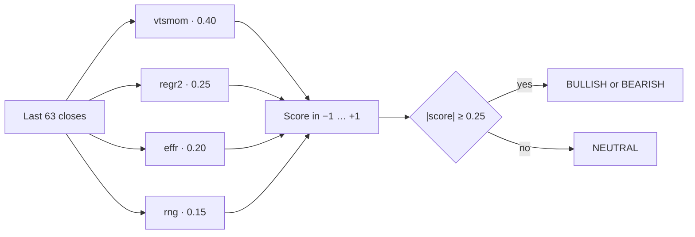

<p align="center">
  <strong>Trend Algo</strong>
</p>

<p align="center">
  Read the last three months of daily closes.<br>
  Return one label: <strong>BULLISH</strong>, <strong>BEARISH</strong>, or <strong>NEUTRAL</strong>.
</p>

<p align="center">
  
  
  
  
</p>

<p align="center">
  <a href="#quick-start">Quick start</a> ·
  <a href="#how-a-label-is-made">How a label is made</a> ·
  <a href="#what-the-backtests-recorded">Backtests</a> ·
  <a href="#sample-on-the-bundled-data">Sample output</a>
</p>

A short price window is noisy. A single return treats a calm 8% drift in a bond ETF as weaker than a jumpy 8% drift in a stock. This classifier turns the last **63 trading days** into one score in **[−1, +1]**, then a label, a confidence tier, and the four component scores that produced it.

The label is aimed at the **next 3–6 months**. In the project's own tests, the same score had no useful relationship with the next month.

---

## Quick start

Python 3.9 or newer. No installs.

```bash
git clone https://github.com/25wrt2wrbr-max/trend-algo.git
cd trend-algo
python3 trend_classifier.py
```

With no arguments the script reads every `data/*.json` file and prints a table. Pass paths to score specific files:

```bash
python3 trend_classifier.py data/spy.json data/btc.json
```

From your own series:

```python
from trend_classifier import classify

closes = [...]  # daily closes, oldest first, at least 63 values
result = classify(closes)

result.label        # "BULLISH" | "BEARISH" | "NEUTRAL"
result.score        # float in [-1, +1]
result.confidence   # "strong" | "moderate" | "weak" | "flat"
result.parts        # {"vtsmom", "regr2", "effr", "rng"}
```

Only the **last 63 closes** are scored. Longer history is accepted and ignored beyond that window. Fewer than 63 closes raises `ValueError`.

Each input should be split- and dividend-adjusted daily closes. Crypto can be unadjusted. Bars should be regularly spaced.

---

## How a label is made



Missing components are dropped and the remaining weights are renormalized. If every component fails, the label is `NEUTRAL` with confidence `uncomputable`.

### The four components

| Piece | Weight | What it measures |
| --- | ---: | --- |
| `vtsmom` | 0.40 | Window return divided by realized volatility, saturated at ±3 window-sigmas. A quiet move counts as much as a wild one of the same volatility-adjusted size. |
| `regr2` | 0.25 | Linear slope across the window, scaled so a smooth ±30% move is ±1, then multiplied by R². A trend that is two outlier days scores near zero. |
| `effr` | 0.20 | Kaufman efficiency ratio: net change divided by the sum of absolute daily changes, signed. A straight path scores high. Chop scores near zero. |
| `rng` | 0.15 | Where the last close sits inside the window's high–low, rescaled to [−1, +1]. Closing on the high is +1. |

### From score to words

```
−1.0        −0.45    −0.25          0          +0.25    +0.45        +1.0
├───────────┼────────┼──────────────┼──────────────┼────────┼───────────┤
│  BEARISH  │ BEARISH│              │              │BULLISH │  BULLISH  │
│  strong   │moderate│   NEUTRAL    │   NEUTRAL    │moderate│  strong   │
└───────────┴────────┴──────────────┴──────────────┴────────┴───────────┘
```

| \|score\| | Label | Confidence |
| --- | --- | --- |
| ≥ 0.45 | BULLISH or BEARISH, by sign | `strong` |
| ≥ 0.25 | BULLISH or BEARISH, by sign | `moderate` |
| ≥ 0.10 | NEUTRAL | `weak` |
| below 0.10 | NEUTRAL | `flat` |

`0.25` was chosen on the first 80% of each series and then held fixed. Between 0.20 and 0.30 the recorded results stay similar.

`NEUTRAL` means the score is too small to call a direction. In this equity-heavy sample, neutral windows still drifted up on average. The band is about score size, and it is a weak description of "price will go flat."

---

## What the backtests recorded

Seven series, daily bars from **11 Oct 2021** through **9 Oct 2026** (BTC-USD through **11 Oct 2026**): **SPY, QQQ, AAPL, NVDA, GLD, TLT, BTC-USD**.

Each day, the classifier labels the trailing 63 sessions. The test then measures the forward return. The first 80% of each timeline is the fit window. The last 20% is out of sample.

These figures are the ones written up in `trend_classifier.py` after that work. They describe this sample.

### Six-month horizon, vol-normalized ensemble

| Check | Fit window | Out of sample |
| --- | ---: | ---: |
| Score vs future return, Spearman ρ | +0.127 | **+0.070** |
| BULLISH labels followed by a positive 6-month return | 77% | **65%** |
| BEARISH labels followed by a negative 6-month return | — | **81%** (n = 145) |

On those out-of-sample bearish windows, the mean forward return was **−5.7%** over six months. Pooled across fit and test, bearish-label accuracy was 45%: the fit window was a strong up-drift regime, and most of the real down-moves sat in the held-out slice.

### Why this blend

Out-of-sample Spearman ρ at six months, from the variants that were written down:

| Variant | OOS ρ |
| --- | ---: |
| This ensemble, vol-normalized momentum | **+0.070** |
| Momentum + efficiency only | +0.064 |
| Same four-piece blend with raw momentum | +0.060 |
| Raw time-series momentum alone | +0.054 |
| Equal weight on five raw indicators | +0.046 |

Vol-normalization also lifted out-of-sample bearish accuracy to 0.81, against 0.38–0.65 for the raw-momentum variants.

### Horizon

| Judge the label this far ahead | Out-of-sample ρ |
| --- | --- |
| 1 month (21 sessions) | about −0.04 to −0.11 |
| 3 months (63 sessions) | about −0.11 to +0.06 |
| 6 months (126 sessions) | **+0.060 to +0.070** |

A three-month chart here is a comment on the next three to six months.

### Read the bearish label carefully

On broad equity indexes in this sample, a bearish label often preceded a bounce at the one-month horizon. The recorded figure for bearish SPY windows is **+3.6%** over the next month. Treat a bearish index label as a sign of a stressed regime. The six-month results are where the bearish labels lined up with later losses.

Other limits recorded with the backtest:

- The basket was net-up for most of 2021–2026. True down-regime observations are few. TLT in 2022 is the main one, and there the labels worked.
- TLT had the weakest per-asset correlation.
- Nothing here is a claim that the relationship continues.

The scripts under `scripts/` are the lab trail: indicator mixes, weight sets, a reversed split, and the 21-, 63-, and 126-session horizons. `trend_classifier.py` is the blend those runs settled on. Run a script from the repo root with `python3 scripts/<name>.py`.

---

## Sample on the bundled data

Scored on the files in `data/`, whose last bars are **9 Oct 2026** for the ETFs and stocks and **11 Oct 2026** for BTC-USD. This is a snapshot inside the repo, and it is stale relative to any later session.

```
asset      label      score conf        vtsmom   regr2    effr     rng
AAPL       NEUTRAL    0.212 weak         0.175   0.033   0.091   0.772
BTC        BULLISH    0.529 strong       0.574   0.558   0.281   0.690
GLD        NEUTRAL   -0.009 flat         0.093   0.008   0.043  -0.378
NVDA       NEUTRAL    0.231 weak         0.156   0.257   0.076   0.597
QQQ        NEUTRAL    0.241 weak         0.167   0.131   0.085   0.830
SPY        BULLISH    0.276 moderate     0.236   0.048   0.112   0.980
TLT        BEARISH   -0.352 moderate    -0.415  -0.142  -0.206  -0.729
```

---

## Data

Each `data/*.json` file is a Yahoo Finance chart response, saved as a small wrapper (`status` plus the raw body text) and parsed with the standard-library `json` module. Adjusted closes are used when Yahoo includes them.

| File | Symbol | Bars | First | Last |
| --- | --- | ---: | --- | --- |
| `spy.json` | SPY | 1,255 | 11 Oct 2021 | 9 Oct 2026 |
| `qqq.json` | QQQ | 1,255 | 11 Oct 2021 | 9 Oct 2026 |
| `aapl.json` | AAPL | 1,255 | 11 Oct 2021 | 9 Oct 2026 |
| `nvda.json` | NVDA | 1,255 | 11 Oct 2021 | 9 Oct 2026 |
| `gld.json` | GLD | 1,255 | 11 Oct 2021 | 9 Oct 2026 |
| `tlt.json` | TLT | 1,255 | 11 Oct 2021 | 9 Oct 2026 |
| `btc.json` | BTC-USD | 1,827 | 11 Oct 2021 | 11 Oct 2026 |

`scripts/fetch_one.sh` refreshes one ticker through Moli, a local browser client pointed at Yahoo's chart page:

```bash
scripts/fetch_one.sh SPY data/spy.json 5y
```

`scripts/load_prices.py` turns one of those files into dates and closes.

---

## Layout

```
trend-algo/
├── trend_classifier.py    the classifier and the demo
├── data/                  bundled Yahoo chart samples
└── scripts/               backtests and the fetcher
```

---

## References

The weights are fixed. The citations are why each piece is there.

- Moskowitz, Ooi, and Pedersen (2012), *Journal of Financial Economics* 104(2). Time-series momentum.
- Barroso and Santa-Clara (2015), *Journal of Financial Economics* 116(1). Volatility-managed momentum.
- Kaufman, *Trading Systems and Methods*. The efficiency ratio.
- Jegadeesh (1990), *Journal of Finance* 45(3). Short-horizon reversal, which is why a one-month judgment is the wrong test for this label.

---

<p align="center">
  <sub>Historical statistics on seven liquid series. A label is a description of the last 63 closes and of how similar windows behaved in this sample. It is not a forecast you should trade on.</sub>
</p>
